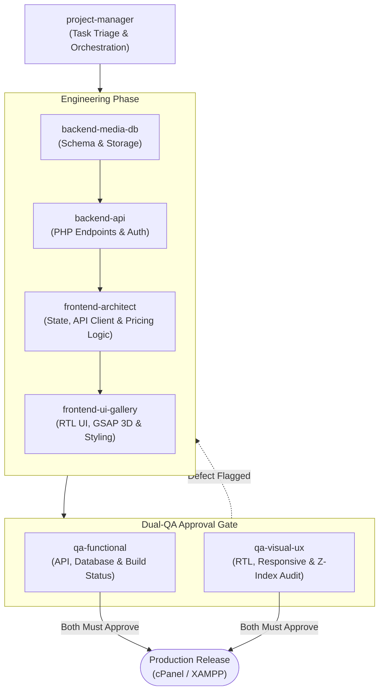

# Tablosazi Maleki (tablosazimaleki.ir) — Multi-Agent Engineering Blueprint

This document defines the specialized AI agent roles, technical boundaries, and operational workflows for the **Tablosazi Maleki** signage workshop website.

---

## 1. Project Overview & Architecture

- **Domain:** Custom signage, neon flex, channel letters, lightboxes, and metal fabrication workshop website (`https://tablosazimaleki.ir/`).
- **Backend:** Pure PHP 8.1+ with PDO. Framework-free architecture designed for zero-dependency deployment on cPanel shared hosting (Apache with `.htaccess` mod_rewrite) and local testing on XAMPP / PHP CLI (`php -S localhost:8000 backend/router.php`).
- **Database:** MySQL 5.7+ / 8.0 (InnoDB, `utf8mb4_unicode_ci`) with single-row section architecture for content tables (`hero_content`, `about_content`, `contact_content`, `footer_content`) and composite keys for cross-device likes (`project_likes`).
- **Frontend:** React 18, Vite, Tailwind CSS, GSAP (Draggable + InertiaPlugin), Lucide React.
  - Persian RTL layout with `Vazirmatn` typography and Persian numerals (`faNum()`).
  - Dynamic 8-palette theme engine (`ember`, `ocean`, `forest`, `violet`, `gold`, `rose`, `teal`, `midnight`).
- **Key Modules:**
  1. **3D Coverflow Showcase (`FeaturedSlider`):** GSAP-driven interactive 3D perspective carousel.
  2. **Filterable Portfolio Gallery (`Gallery`, `Lightbox`):** Dynamic category tabs, search, likes, and WhatsApp direct ordering.
  3. **Interactive Neon Font Previewer (`FontPreview`):** Live neon letter simulation with admin font uploads (`.ttf`, `.woff2`).
  4. **Instant Signage Cost Calculator (`PriceCalculator`):** Real-time letter perimeter, lighting, transformer, and material cost estimation.
  5. **Cross-Browser Device-Fingerprinted Likes:** Visitor UUID + device IP verification preventing duplicate votes across different browsers on the same machine.
  6. **Secure Admin Panel (`Dashboard.jsx`, `Login.jsx`):** Token session auth, CSRF, rate-limited login, portfolio CRUD, and live site customizer.

---

## 2. Agent Roster & Ownership Directory

| Agent Name | Skill Path | Primary Ownership & Scope | Key Technologies |
| :--- | :--- | :--- | :--- |
| **`project-manager`** | `.agent/skills/project-manager/SKILL.md` | System orchestration, task triage, cross-agent coordination, and dual-QA gate enforcement | Agile Orchestration, Technical Architecture |
| **`backend-api`** | `.agent/skills/backend-api/SKILL.md` | Pure PHP REST API dispatching, routing, authentication, CSRF, input validation, and rate limiting | PHP 8.1+, PDO, REST APIs, Security |
| **`backend-media-db`** | `.agent/skills/backend-media-db/SKILL.md` | MySQL schemas, PDO connection manager, image & font upload security, cPanel Apache rules | MySQL/InnoDB, File Uploads, Apache `.htaccess` |
| **`frontend-architect`** | `.agent/skills/frontend-architect/SKILL.md` | Frontend architecture, API client, pricing calculation logic, admin CRUD state, and Vite build pipeline | React 18, Vite, Hooks, State Management |
| **`frontend-ui-gallery`** | `.agent/skills/frontend-ui-gallery/SKILL.md` | Persian RTL UI presentation, Tailwind styling, GSAP 3D Coverflow carousel, and theme tokens | Tailwind CSS, GSAP, CSS 3D Transforms, RTL |
| **`qa-functional`** | `.agent/skills/qa-functional/SKILL.md` | End-to-end functional testing, API contracts, device like synchronization, pricing math, and build verification | API Testing, Data Integrity, Verification |
| **`qa-visual-ux`** | `.agent/skills/qa-visual-ux/SKILL.md` | Visual layout inspection, typography audit, responsive breakpoints, z-index collision checks, and theme harmony | Visual QA, RTL Polish, Layout Auditing |

---

## 3. Strict Layering & Stacking Context Hierarchy

To prevent visual collisions (e.g. 3D carousels or cards obscuring sticky headers or buttons), all agents must strictly enforce:

1. **Page Content & 3D Carousels (`z-index: 1` - `25`):**
   - The `.coverflow-container` must declare `isolation: isolate; z-index: 1;`.
   - Internal edge gradients (`.coverflow-edge-left`, `.coverflow-edge-right`) must not exceed `z-index: 15`.
   - Internal hint pills must not exceed `z-index: 20`.
2. **Sticky Site Header (`z-index: 50`):**
   - `.site-header` is sticky (`top: 0; z-index: 50;`).
   - Scrolled state activates frosted glass with high opacity (`background: color-mix(in srgb, var(--bg) 95%, transparent); -webkit-backdrop-filter: blur(12px); backdrop-filter: blur(12px);`) so content never bleeds through the «مشاوره رایگان» CTA button or navigation menu.
3. **Modals & Lightbox (`z-[60]`):**
   - Fullscreen Lightbox and Admin editing dialogs render at `z-[60]` to safely cover the header and page background.
4. **System Notifications & Toasts (`z-[70]`):**
   - Floating toasts render at `z-[70]` to remain visible over active modals.

---

## 4. Multi-Agent Development Workflow

1. **Intake & Triage:** `project-manager` assesses the requirement, determines affected components, and issues focused tasks to the relevant engineering agents.
2. **Implementation:**
   - Database / Schema updates are handled by `backend-media-db`.
   - API routing, controller logic, and validation are implemented by `backend-api`.
   - Frontend state, API integration, and calculations are built by `frontend-architect`.
   - UI styling, Persian RTL presentation, and animations are refined by `frontend-ui-gallery`.
3. **Build Check:** `frontend-architect` executes `npm run build --prefix frontend` to confirm zero compilation errors.
4. **Dual-QA Gate:**
   - `qa-functional` tests API payloads, status codes, database integrity, and calculation edge cases.
   - `qa-visual-ux` inspects responsive breakpoints, typography, stacking context, and theme colors.
5. **Approval:** A feature or bug fix is only considered finished when both QA agents provide explicit approval.
